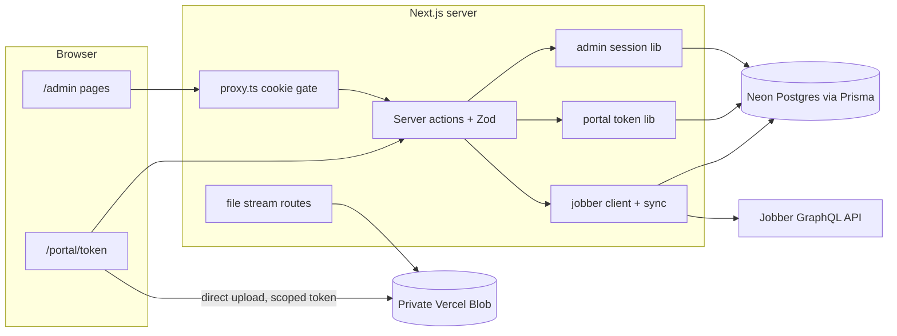

# Elite Restorations: Admin Dashboard and Material Selection Portal

## What the repo already has (verified)

- Next.js 16.4 App Router, React 19, TS strict, Tailwind v4, shadcn (`radix-nova`, Aceternity registry in [components.json](components.json)), `motion`, Zod 4, tRPC (contact form only), Vercel hosting with a cron in [vercel.json](vercel.json).
- Tests: `node --test --experimental-strip-types` with the resolver in [scripts/test-resolver.mjs](scripts/test-resolver.mjs) (stubs `server-only`, resolves `@/`).
- Jobber OAuth (PKCE, refresh rotation) in [src/server/jobber/](src/server/jobber/): `config.ts`, `tokens.ts`, `graphql.ts`, `oauth-state.ts`, `sync.ts` (lead intake creates Clients and Requests). Tokens are plaintext JSON in the private Blob `jobber/oauth.json`. Connect is gated by `?key=JOBBER_CONNECT_KEY`. Current scopes: clients and requests.
- No database, no admin auth. `src/generated/prisma` is a leftover from another project and will be left in place.
- [src/app/layout.tsx](src/app/layout.tsx) puts `SiteHeader`, `SiteFooter`, and `CallTextBar` on every route. It must stay static (it does not call `headers()`).
- [src/proxy.ts](src/proxy.ts) is the Next 16 proxy (it handles WordPress 410s).
- The private Blob store (`JOBBER_BLOB_READ_WRITE_TOKEN`, helpers in [src/server/private-blob.ts](src/server/private-blob.ts)) is reused for customer uploads.

## Architecture

## Key decisions

- **Layout opt-out without moving public routes:** add a client `SiteChrome` component that receives the header, footer, and call bar as props and renders nothing for `/admin` and `/portal` paths (using `usePathname`). Public pages stay static and keep the same files. Admin and portal get their own nested layouts with their own chrome.
- **Database:** Neon Postgres through the Vercel Marketplace, Prisma 7 with `prisma.config.ts`, the `prisma-client` generator writing to `src/server/db/generated` (gitignored, generated in `postinstall`), and `@prisma/adapter-neon`. The singleton lives in `src/server/db/client.ts`.
- **Admin auth (custom, no Auth.js):** Auth.js discourages its credentials provider, so a small custom module is safer here:
  - Passwords use Node `crypto.scrypt` (N=2^17, r=8, p=1).
  - Sessions are random 32-byte tokens. Only their SHA-256 hash is stored in `AdminSession`. The cookie is `__Host-er_admin`: HttpOnly, Secure, SameSite=Lax, 12 hour idle timeout, 7 day absolute limit.
  - Login is rate limited in the database (`LoginAttempt`, keyed by IP and email, 5 attempts per 15 minutes), so the limit holds across serverless instances.
  - [src/proxy.ts](src/proxy.ts) only checks that the cookie exists for `/admin/*` and redirects to `/admin/login`. Every layout, action, and route still checks the session and role in the database with `requireAdmin()` / `requireRole()`.
  - No public sign-up. The first admin is created with `npm run admin:create` (`scripts/create-admin.ts` via `tsx`).
  - Roles are `ADMIN` and `STAFF`. Staff can't see quote totals or allowances, or manage integrations and users.
- **Jobber tokens move to Postgres:**
  - A single `JobberConnection` row holds the access and refresh tokens, encrypted with AES-256-GCM (`APP_ENCRYPTION_KEY`, with a key id for rotation).
  - A `version` column handles concurrent refreshes, replacing the Blob etag logic.
  - `tokens.ts` keeps its public API, so lead intake ([src/server/jobber/sync.ts](src/server/jobber/sync.ts), [src/server/leads/jobber.ts](src/server/leads/jobber.ts)) doesn't change.
  - The first read imports the existing `jobber/oauth.json` if it is present, so there is no forced reconnect. After that it is deleted.
- **Jobber connect UI:** `/admin/settings/integrations` shows status, scopes, last sync, and Connect / Reconnect / Disconnect.
  - `/api/jobber/connect` accepts an admin session, and still accepts the old `?key=` link.
  - The callback redirects back to the settings page.
  - The redirect URI can be overridden with `JOBBER_REDIRECT_URI`, so preview deployments can use their own.
- **Jobber reads (read-only in V1):**
  - All queries live in `src/server/jobber/queries.ts`. Every field is checked against the official docs and the live schema (introspection run once after reconnecting) before it is used. Nothing is guessed.
  - `graphql.ts` gets cursor pagination (`pageInfo { hasNextPage endCursor }`), throttle handling from `extensions.cost.throttleStatus` and `THROTTLED` errors, and exponential backoff on 429 and 5xx.
  - Sync is resumable: a `JobberSyncRun` row stores the cursor, so a large account can sync in batches without hitting the function time limit.
  - Required scopes: read clients and read quotes, in addition to the existing ones. The new quotes scope has to be added in the Developer Center, then Jobber reconnected once.
- **Webhooks:** `/api/jobber/webhooks` checks `X-Jobber-Hmac-SHA256` (HMAC-SHA256 of the raw body with the client secret, compared in constant time). Each event triggers a re-fetch of that one quote or client. Subscriptions are registered later.
- **Mock mode:** `JOBBER_MODE=mock` (the default locally when no connection exists) runs fixtures from `src/server/jobber/fixtures.ts` through the same sync code. Records get `source = MOCK`, and the admin UI shows a "Demo data, not from Jobber" banner.
- **Portal tokens:**
  - 32-byte `randomBytes` encoded as base64url.
  - The `tokenHash` (SHA-256) is used for lookup. A `tokenEncrypted` copy (AES-GCM) lets an admin copy the link again later.
  - Portals support revoke, regenerate (which invalidates the old token), and an optional `expiresAt`.
  - Portal responses send `no-store`, `noindex`, and `Referrer-Policy: no-referrer`.
  - `/admin` and `/portal` are disallowed in [src/app/robots.ts](src/app/robots.ts).
- **Uploads:**
  - Files go straight from the browser to the private Blob store through `@vercel/blob/client`. A `handleUpload` route at `/api/portal/[token]/upload` checks the portal, that the selection is still editable, the file type (jpeg, png, webp, heic, pdf), a 10 MB limit, and the `portal-uploads/{portalId}/{selectionId}/` path prefix.
  - A server action then registers the `Attachment` after confirming the prefix, size, and type with `head()`.
  - Files are only served through authorized streaming routes: `/api/portal/[token]/files/[id]` and `/api/admin/files/[id]`.
  - Fallback if client uploads to a private store don't work: upload through the server, with images shrunk in the browser to under 4 MB.
- **Category suggestions:** a scoring function compares each line item's name and description against category keywords, synonyms, and negative terms, plus a bonus for "allowance". It returns suggestions with a confidence score and the reason. Nothing is created until the admin accepts it. Categories are editable rows, seeded with the 12 templates.
- **Selection states:**
  - `transition(status, event, actor)` is a pure function covering NOT_STARTED, DRAFT, SUBMITTED, CHANGES_REQUESTED, and APPROVED. It has unit tests.
  - A `version` column prevents overwrites, and submitted selections are read-only.
  - Each submission creates an immutable `SelectionRevision`.
  - Approval is labeled "internal material approval only" everywhere it appears.

## Data model (Prisma, `prisma/schema.prisma`)

Internal IDs are cuids. Jobber IDs are kept as `jobberId @unique`. Most foreign keys use `onDelete: Restrict`; requirement to selection to revision/attachment cascade.

- `AdminUser` (email unique, name, passwordHash, role, active), `AdminSession`, `LoginAttempt`
- `JobberConnection` (singleton, encrypted tokens, scopes, account name, status, version), `JobberSyncRun`
- `JobberClient`: a minimal cached copy for search (name, company, primary email, phone, address, source, syncedAt). Jobber stays the source of truth.
- `JobberQuote` (clientId, quoteNumber, title, status, quote date, total as Decimal and admin-only, property address, Jobber web link), `JobberQuoteLineItem`
- `SelectionCategory` (template: name, slug, default instructions, enabled fields JSON, keywords, active, sortOrder)
- `CustomerPortal` (quoteId, tokenHash unique, tokenEncrypted, status DRAFT, PUBLISHED, or REVOKED, welcome message, showAllowances, expiresAt, createdBy). At most one non-revoked portal per quote, enforced with a partial unique index in SQL.
- `SelectionRequirement` (portalId, categoryId, lineItemId optional, area, title, instructions, customerGuidance, required, quantity, unit, allowanceCents for internal use, preferredOptions JSON, enabledFields JSON, dueDate, sortOrder)
- `MaterialSelection`: one per requirement (unique requirementId). Stores status, the draft fields (product, manufacturer, model or SKU, color, finish, dimensions, product URLs, notes), version, and submittedAt.
- `SelectionRevision` (unique selectionId and revisionNumber, snapshot JSON), `Attachment`, `SelectionReview` (decision, internal note, customer feedback, reviewerId, timestamp)
- `ActivityLog` (actor type and id, action, entity, portalId, metadata, timestamp)

Every portal query is scoped by the `portalId` resolved from the token hash, so one customer can never load another portal's records. `docs/admin-portal.md` will explain how these tables relate.

## Routes

- Admin pages:
  - `/admin/login`, `/admin` (dashboard)
  - `/admin/customers`, `/admin/customers/[id]`
  - `/admin/quotes`, `/admin/quotes/[id]`
  - `/admin/portals`, `/admin/portals/new?quoteId=`, `/admin/portals/[id]` (the builder)
  - `/admin/selections`, `/admin/selections/[id]`
  - `/admin/settings`, `/admin/settings/integrations`, `/admin/settings/categories`
- Customer page: `/portal/[token]`
- API: `/api/portal/[token]/upload`, `/api/portal/[token]/files/[id]`, `/api/admin/files/[id]`, `/api/jobber/webhooks`, plus the existing connect and callback routes.
- Changes go through server actions in `src/server/admin/*` and `src/server/portal/*`, with Zod validation and the auth guard called first in every action. tRPC stays for the contact form only.

## UI

- Install shadcn pieces as needed: sidebar (collapsible), table, card, badge, dialog, sheet, dropdown-menu, skeleton, progress, tooltip, sonner, plus dnd-kit for drag-and-drop reordering in the builder.
- The admin theme uses charcoal, black, white, and neutral colors on top of the existing CSS variables. It uses the existing fonts and `SiteLogo`.
- Every list and form gets a `loading.tsx`, an empty state, an error state, and a confirmation dialog.
- The portal is mobile-first. It shows the logo, customer and project details, welcome text, "X of Y completed" progress, a card per selection, and contact info from [src/lib/site.ts](src/lib/site.ts).

## Phases (each phase must pass `typecheck`, `lint`, `test`, and `build` before the next starts)

1. **Foundation:**
   - Add Prisma, Neon, and the schema with its first migration.
   - Add the encryption and session libraries, the login page, and the proxy gate.
   - Add `SiteChrome` so the public header, footer, and call bar stay off admin and portal pages.
   - Build the admin shell with sidebar navigation and the dashboard cards backed by real counts.
   - Add the `admin:create` script.
2. **Jobber:**
   - Move the token store to the database and import the existing Blob tokens.
   - Build the integrations page, verified queries, pagination, retries and throttling, the resumable sync, and mock mode.
   - Build the customer and quote tables and detail pages, plus the webhook endpoint.
3. **Portal builder:**
   - Seed the category templates and build the suggestion engine.
   - Build the builder: pick line items, accept suggestions, add, edit, reorder, and remove requirements, then publish.
   - Add token issue, copy, revoke, and regenerate.
4. **Customer portal:** selection forms, draft saving and submission with version checks, private uploads, and progress tracking.
5. **Review and QA:**
   - Build the `/admin/selections` filters, the approve / request changes / reopen actions, revision history, and the activity log.
   - Write tests, seed demo data, update the docs, and check layouts at different screen sizes in the browser.

## Tests (`node --test`, mocked Jobber via `fetch` stubs)

- Password hashing and verification, session expiry, rate limiting, role guards
- Token encryption round trip, refresh rotation, concurrent version conflict, importing the Blob tokens
- Pagination and throttling/retry using fixture pages, mapping Jobber data into the database rows
- Portal token lookup, revocation and expiry, cross-portal isolation (portal A's token can't reach portal B's selection or file)
- Zod submission validation, upload type, size, and path rules
- Every status transition, review history entries, and the category suggestion scores

## Seed, docs, env

- `prisma/seed.ts`: category templates, plus fake MOCK clients, quotes, and a demo portal. No real customer data.
- New env vars, documented in [.env.example](.env.example): `DATABASE_URL` (set by Neon), `APP_ENCRYPTION_KEY`, `JOBBER_MODE`, `JOBBER_REDIRECT_URI` (optional), `JOBBER_WEBHOOK_ENABLED`.
- Docs:
  - `docs/admin-portal.md`: architecture, data relationships, local development, and the demo flow
  - `docs/deployment-checklist.md`: Neon provisioning, migration with `prisma migrate deploy`, environment variables, Jobber scopes and reconnecting, creating the admin account, and security checks
  - [docs/jobber.md](docs/jobber.md): updated for database token storage and the new connect process
- The live Jobber quote sync will only be reported as working after it has been reconnected with the new scope and checked against the real account. Until then, the UI and docs mark it as mock.

## Requires you (outside the code)

- Install Neon from the Vercel Marketplace on this project, then run `vercel env pull`.
- Add the quotes read scope to the Jobber app in the Developer Center, and reconnect from the new integrations page.
- Generate `APP_ENCRYPTION_KEY` with `openssl rand -base64 32` and set it in Vercel.
