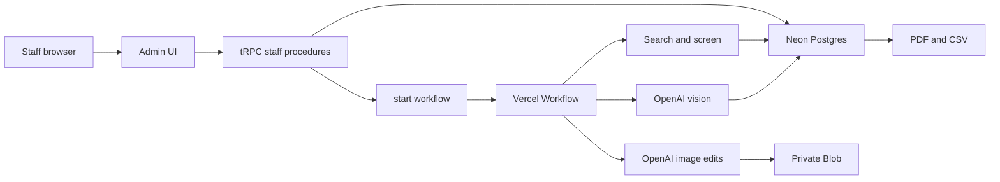

# Renovation Opportunity Finder

## What exists

Elite Restorations is a public marketing site: Next.js 16.3, React 19, tRPC 11, Zod 4, Tailwind 4, and `pdf-lib`. Lead photos already go to a **public** Vercel Blob store in [`src/server/leads/photos.ts`](src/server/leads/photos.ts). There is no database, authentication, or background job system. Contact is the only tRPC router ([`src/server/trpc/router.ts`](src/server/trpc/router.ts)).

The public site stays as it is. The finder is a new staff-only area. Marketing chrome moves into a `(site)` route group so `/admin` does not render the public header and footer. URLs and public page content stay the same.

## Architecture

- **API:** new `staffProcedure` on the existing tRPC router. Public `contact.submit` stays public. Asset downloads use an authenticated route, not public Blob URLs.
- **Auth:** Clerk, invite-only, matcher limited to `/admin`. An `ADMIN_EMAILS` allowlist is checked on every staff procedure. `/admin` is `noindex` and disallowed in [`src/app/robots.ts`](src/app/robots.ts).
- **Database:** Neon Postgres with Prisma. The schema lives in `prisma/schema.prisma`, and `prisma migrate` owns the SQL migrations. The client is a lazy `getPrisma()` singleton using `@prisma/adapter-neon`, so `next build` does not connect when `DATABASE_URL` is absent. This stays on the Neon database already chosen for the app; Prisma here is the ORM, not a second hosted Postgres. Spend reservations use an interactive `prisma.$transaction` with a row lock so in-flight work counts against the cap. Queries and transactions run inside workflow steps, where Node and the driver are available.
- **Jobs:** Vercel Workflow (`workflow` + `withWorkflow`). The browser only starts, cancels, or resumes a run. `"use workflow"` orchestrates; `"use step"` does Node, database, and model work. Review-before-generation waits on a workflow hook that an authenticated procedure resumes. Retries use `RetryableError`; permanent failures use `FatalError`. A timeout leaves the task `uncertain` and does not send the same paid request again.
- **Files:** a second, **private** Blob store, addressed with its own token so lead photos stay on the existing public store. The app streams bytes only after an auth check.
- **AI:** room analysis uses the AI SDK structured output (`generateText` + `Output.object`) with a configurable OpenAI vision model, `OPENAI_VISION_MODEL`, routed through the Vercel AI Gateway when OIDC is available. Concept images use the official Image API `POST /v1/images/edits`. The current docs name `gpt-image-2.5-sunburst` for edit precision; that is the default `OPENAI_IMAGE_MODEL`. Each call sends `n: 1`, a configurable `quality` of `low` | `medium` | `high`, and `output_format: jpeg`. `input_fidelity` is sent only if the edits reference for that model lists it. Each tier is edited from the original photo, never from another tier. Usage tokens from the response are stored as recorded cost; pre-run figures stay labeled estimates.

Listing text and any text inside photos are passed as untrusted data, never as model instructions.

## Listing access

Capabilities are stored per provider and shown in the setup screen: sold search, exact sale price, sale-price range, sale date, photos, AI processing, derivative images, export, and local retention. A failed provider never falls through to scraping. A pasted HAR or Zillow URL is saved as a reference key only.

**Repliers / HAR**, implemented from current docs, not from page markup:

- Auth header: `REPLIERS-API-KEY` ([authentication](https://docs.repliers.io/reference/authentication)).
- Sold search: `GET https://api.repliers.io/listings?status=U&lastStatus=Sld` plus `minClosedDate` / `maxClosedDate` ([sold listings guide](https://help.repliers.com/en/article/a-guide-to-accessing-sold-leased-listings-19alfew/)). Pending, active, and leased (`Lsd`) records are excluded. Only records with a closed date inside the Chicago-local window qualify.
- Photos are relative `images` paths prefixed with `https://cdn.repliers.io/` ([image guide](https://help.repliers.com/en/article/listing-images-implementation-guide-198p8u8/)).

Eligibility is not an IDX checkbox. Repliers requires a subscription tied to a named HAR broker, agent, or a vendor with its own MLS license ([licensing requirements](https://help.repliers.com/en/article/mls-requirements-for-data-licensing-when-signing-up-with-repliers-12fknh6/)). HAR terms (Repliers ToS §4.10.1, updated Aug 5, 2026) forbid using HAR data to train models, and allow a request-scoped AI call only inside the subscriber’s own systems when the AI provider cannot use the data for anything else. §4.3 forbids local storage without written authorization. §3.5 and §4.6 restrict derivatives, publishing, and redistribution.

The adapter therefore stays at **Provider not configured** until `REPLIERS_API_KEY` exists, and it refuses photo storage, OpenAI submission, derivative images, and export until separate attestation flags are set. Those flags record the operator’s claim of written authorization; they do not create the right. Without them, live search can be connected later, and the working path is import.

**Zillow:** no live client. Zillow Group data on Bridge is display-only, forbids local storage and derivative works, and does not provide this photo-and-concept workflow ([Zillow Group data](https://www.bridgeinteractive.com/developers/zillow-group-data/)). Bridge MLS access is a separate license and is not assumed. The Zillow card explains that, and that a Zillow URL is only a lookup key.

**Import:** CSV/JSON plus authorized photo uploads. Required price fields keep exact sale price, asking price, reported range, and unknown distinct. Exact-price filters drop unknown prices unless the run explicitly allows them. Range matching is described in the form: a listing matches when its reported range overlaps the filter, and that fact is stored on the run.

## Pipeline

Search a candidate pool larger than the 10/15/20 target, paginate, then normalize, dedupe, verify closed status and date, inspect photos, assess rooms, rank, select, generate, check, and build the report. Stop at candidate, time, or spend limits. If only seven homes qualify, the report contains seven and states the shortfall. Filters are never relaxed.

Deduping uses MLS id first, then normalized street, unit, city, and ZIP. One home is one opportunity. Conflicting sale price or date is flagged, not overwritten.

Default exclusion is **strict property**: a home is excluded when evidence strongly indicates a recent substantial remodel or a clearly updated kitchen or bathroom. **Room opportunity** mode keeps the home and generates concepts only for rooms decided `outdated`. Staging, paint, or one new appliance is not a complete renovation. Decisions are `outdated`, `updated appearance`, `mixed`, and `insufficient evidence`. Ambiguous cases go to review. Staff can correct room type, representative photo, exclusion, and which rooms get concepts.

The opportunity score is a weighted sum of visible remodel strength, photo confidence, sale recency, filter fit, and qualifying-room count, with the components and a plain-language explanation shown. It is not a homeowner-intent or budget claim.

Each selected room gets three independent edits (Refresh, Remodel, Premium) from the same original, using the required base prompt plus room observations, retained elements, tier scope, style, and restrictions. Layout changes stay off unless a run setting enables them, and those outputs are labeled as needing a feasibility review. A second vision pass checks geometry, openings, fixtures, circulation, and scope, and is labeled as an automated check, not a guarantee. Failures retry only inside the retry and spend caps; otherwise the concept is **Needs review**. Images are labeled AI renovation concepts. A property is complete only when every requested concept exists and passes the required check. Early stops are partial reports.

Construction ranges come only from an editable price book. Missing measurements show a broad planning allowance or **Site visit required**. No ROI claim.

Spending: estimate image count before start (for example 20 homes × 2 rooms × 3 tiers = 120 edits, plus analysis calls). Reserve that estimate on the run budget row, including in-flight reservations, before a step dispatches. Recorded usage is stored separately from the estimate.

## Dashboard

`/admin/renovation-opportunities` uses the existing type, color tokens, and UI primitives (`button`, `input`, `tabs`). It includes presets, run history, stage counts, cost, ranked cards, exclusions, before/after tier tabs, room corrections, regenerate-one, cancel/resume, and provider status.

A demo dataset is a separate `origin: demo` run, using the company’s own project photos and fictional addresses. It never appears in a live or imported result set.

Server-side PDF (`pdf-lib`) and CSV export check auth and the record’s export permission. HAR-sourced assets export only when that capability is attested.

## Credentials required before live use

- Neon (`DATABASE_URL`) and Clerk keys, provisioned with the Vercel Marketplace CLI (`vercel` is not installed yet).
- Private Blob token for opportunity assets.
- `OPENAI_API_KEY`, plus AI Gateway OIDC on Vercel for vision cost tracking. Organization verification may be required before GPT Image models run.
- Repliers key and HAR license only when sold search should go live. Storage, AI, derivative, and export attestations stay off until written authorization exists.
- No Zillow credential is useful for this workflow under current published terms.

Import, review, ranking, price book, exports of imported data, and the demo path are built so they run without Repliers or Zillow. OpenAI calls stay behind a configured key. Development will not launch a multi-home paid generation; verification uses unit tests plus one authorized sample image if a key is present.

## Tests

Vitest for sold-date and price filtering, unknown-price exclusion, range overlap, deduping, both exclusion modes, missing photos, Zod schemas, checkpoint recovery without re-sending an uncertain paid call, concurrent reservation against one cap, and export rejection when unauthenticated or export is not permitted.
